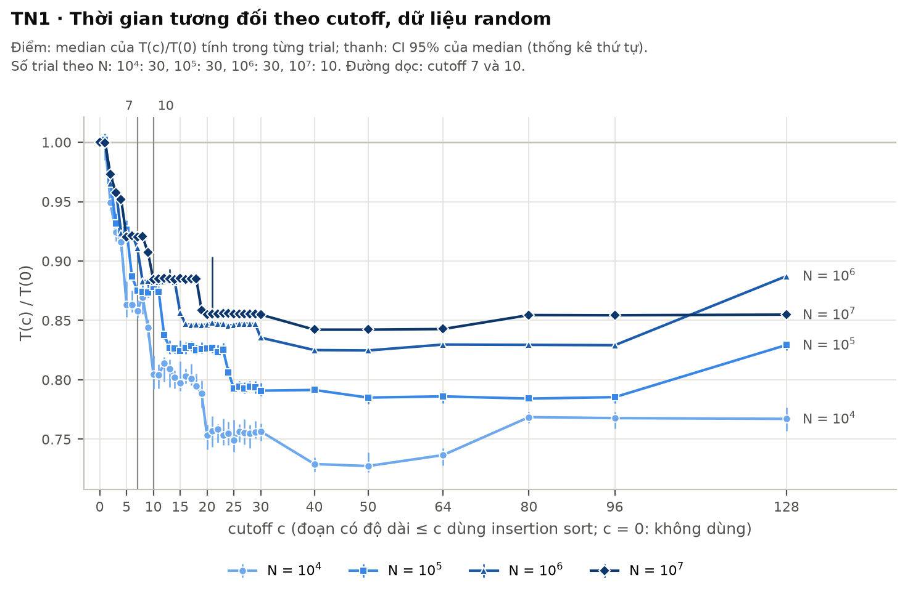
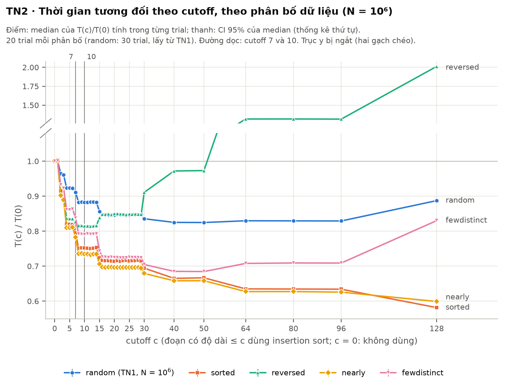
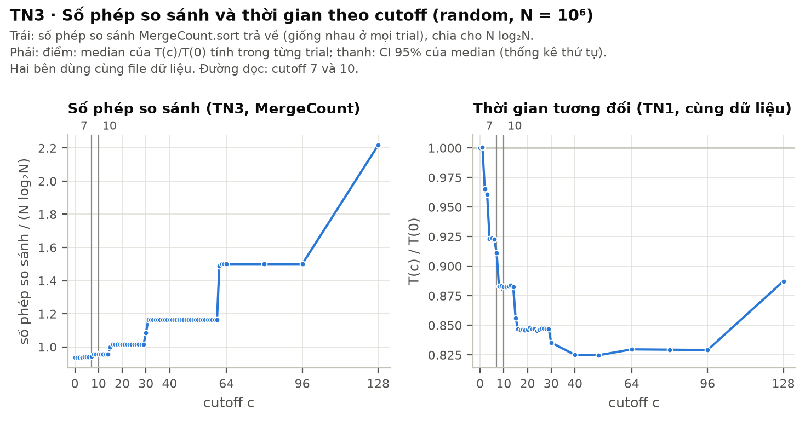
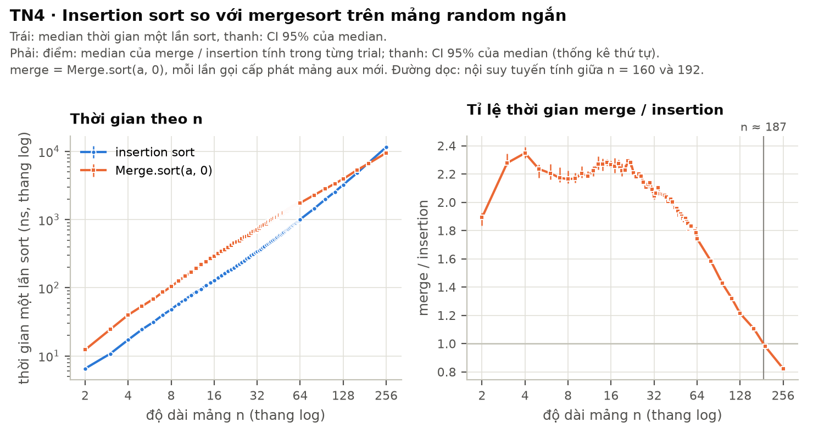
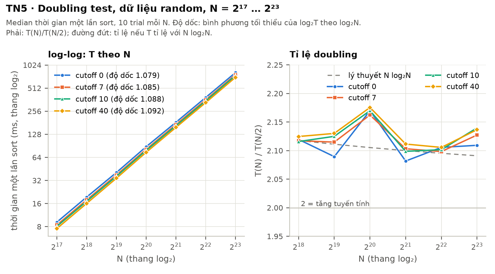
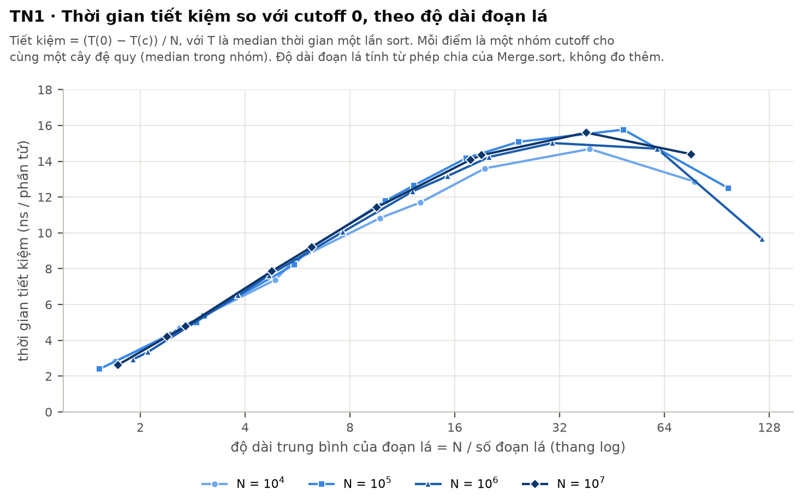

# Tìm CUTOFF tối ưu cho Mergesort

**Báo cáo thí nghiệm, môn Cấu trúc dữ liệu và giải thuật**

Trường Đại học Công nghệ, ĐHQG Hà Nội

Sinh viên: Trần Trung Hiếu · MSSV: 25021769 · Lớp: UET.CS1058_9

Giảng viên: Trần Thị Minh Châu


## Tóm tắt

Mergesort chia mảng đến tận đoạn một phần tử, nên ở các đoạn nhỏ chi phí gọi đệ quy và chép sang mảng phụ chiếm phần lớn thời gian. Cải tiến quen thuộc là dùng insertion sort cho các đoạn có độ dài không quá CUTOFF. Báo cáo này đo thời gian của một bản mergesort tự cài đặt trên `int[]` với CUTOFF từ 0 đến 128, trên 4 kích thước N (10⁴ đến 10⁷) và 5 phân bố dữ liệu, mỗi cấu hình đo 10 đến 30 lần với thứ tự cutoff xáo trộn ngẫu nhiên. Kết luận cho máy đo (Apple M2, JDK 25):

- **CUTOFF nên nằm trong khoảng 40–50; nếu chọn một giá trị thì chọn 40.** Với dữ liệu ngẫu nhiên, cutoff 40 nhanh hơn mergesort không cutoff 16–27%, và nằm trong vùng cách tối ưu không quá 2% ở cả bốn kích thước N.
- **Giữa 7 và 10 thì 10 tốt hơn:** nhanh hơn 1.5–6% và khác biệt có ý nghĩa thống kê ở 14/15 cấu hình đo được. Cấu hình còn lại (N = 10⁵) hai giá trị cho cùng một cây đệ quy nên chạy như nhau. Tuy vậy, trên dữ liệu ngẫu nhiên, dùng cutoff tốt nhất thay cho 7 hoặc 10 còn giảm thêm được 5–15% thời gian.

Phân tích cho thấy đại lượng quyết định thời gian là **độ dài đoạn lá** (đoạn được insertion sort), không phải giá trị cutoff: nhiều cutoff liền nhau cho cùng một cây đệ quy và chạy giống hệt nhau. Đoạn lá dài khoảng 30–50 phần tử là tốt nhất, và phần thời gian tiết kiệm được gần như không đổi, khoảng 15 ns cho mỗi phần tử, ở mọi N.

## 1. Giới thiệu

Mergesort top-down sắp xếp N phần tử với khoảng N log₂N phép so sánh, nhưng nó đệ quy đến tận đoạn một phần tử. Ở những tầng dưới cùng của cây đệ quy, mỗi lần merge chỉ xử lý vài phần tử mà vẫn phải trả đủ chi phí gọi hàm và chép dữ liệu sang mảng phụ `aux`. Insertion sort có độ phức tạp N² nhưng hằng số rất nhỏ, nên trên đoạn ngắn nó có thể nhanh hơn. Bài giảng giới thiệu cải tiến: khi đoạn con đủ ngắn (độ dài ≤ CUTOFF) thì dùng insertion sort thay cho việc chia tiếp.

Đề bài đặt câu hỏi: **nên chọn CUTOFF = 7 hay 10?** Báo cáo trả lời câu hỏi đó bằng thực nghiệm, và mở rộng thành bốn câu hỏi:

1. Trên máy đo, CUTOFF nào cho thời gian nhỏ nhất, và vùng các giá trị "gần tốt nhất" rộng đến đâu?
2. Giá trị tối ưu có thay đổi theo kích thước N và theo phân bố dữ liệu không?
3. Khác biệt giữa 7 và 10 là khác biệt thật hay chỉ là nhiễu đo?
4. Vì sao có điểm tối ưu (cơ chế)?

Mục tiêu là phân biệt khác biệt thật với nhiễu đo, nên mọi kết luận đều kèm khoảng tin cậy hoặc kiểm định thống kê.

## 2. Cơ sở lý thuyết

### 2.1 Chi phí của mergesort trên đoạn nhỏ

Với cutoff 0, mergesort top-down trên N phần tử tạo ra khoảng 2N lời gọi đệ quy (N lá một phần tử và N − 1 nút trong) và khoảng log₂N tầng merge. Ở mỗi tầng, hàm `merge` chép toàn bộ đoạn sang `aux` rồi ghi ngược lại vào `a`, tức khoảng 2N lần di chuyển phần tử cho mỗi tầng, cộng với số phép so sánh không quá N. Các tầng dưới cùng có rất nhiều lời gọi, mỗi lời gọi xử lý rất ít phần tử, nên chi phí cố định của một lần gọi (gọi hàm, tính `mid`, vòng lặp chép) chiếm tỉ trọng lớn.

### 2.2 Insertion sort trên đoạn ngắn

Trên dữ liệu ngẫu nhiên, insertion sort một đoạn L phần tử cần trung bình khoảng L²/4 phép so sánh và L²/4 lần dịch phần tử, tức khoảng L/4 phép so sánh cho mỗi phần tử. Đổi lại, nó không đệ quy, không dùng mảng phụ, chỉ đọc ghi trên một đoạn liên tiếp nằm gọn trong cache L1, và vòng lặp trong rất đơn giản. Trường hợp tốt nhất (đoạn đã sắp xếp) chỉ cần L − 1 phép so sánh; trường hợp xấu nhất (đoạn sắp xếp ngược) cần khoảng L²/2.

### 2.3 Dự đoán

Nếu các đoạn lá dài khoảng L thì cây đệ quy mất đi khoảng log₂L tầng merge ở dưới cùng và số lời gọi giảm từ khoảng 2N xuống khoảng 2N/L. Bù lại, insertion sort tốn khoảng L/4 phép so sánh cho mỗi phần tử, tăng tuyến tính theo L. Có thể viết chi phí trung bình cho mỗi phần tử dưới dạng

  f(L) ≈ α · log₂(N/L) + β · L/4 + γ / L,

trong đó α là chi phí một tầng merge cho mỗi phần tử, β là chi phí một bước của insertion sort, γ là chi phí cố định của một lời gọi. Từ đó có ba dự đoán để kiểm chứng:

- **Đường chữ U:** thời gian giảm khi cutoff tăng từ 0, đạt đáy, rồi tăng lại khi số hạng L/4 chiếm ưu thế.
- **Điểm tối ưu gần như không phụ thuộc N:** đạo hàm của f theo L không chứa N, nên L tối ưu chỉ phụ thuộc vào các hằng số α, β, γ của máy.
- **Phần tiết kiệm tỉ lệ với N:** cutoff bỏ đi một số tầng merge cố định, nên thời gian tiết kiệm là một số hạng bậc N. Tổng thời gian tăng như N log N, nên tỉ lệ cải thiện sẽ giảm dần khi N tăng, và cutoff không làm thay đổi bậc tăng trưởng.

## 3. Cài đặt

### 3.1 Merge.java

Mergesort được tự cài đặt từ bài giảng, dạng top-down với mảng phụ `aux` cấp phát một lần cho mỗi lần sắp xếp. Ba hàm chính:

```java
public static void sort(int[] a, int cutoff) {
    int n = a.length;
    int[] aux = new int[n];
    sort(a, aux, 0, n - 1, cutoff);
}

private static void sort(int[] a, int[] aux, int lo, int hi, int cutoff) {
    if (hi <= lo) return;
    if (hi <= lo + cutoff - 1) {
        insertionSort(a, lo, hi);
        return;
    }
    int mid = lo + (hi - lo) / 2;
    sort(a, aux, lo, mid, cutoff);
    sort(a, aux, mid + 1, hi, cutoff);
    merge(a, aux, lo, mid, hi);
}

private static void merge(int[] a, int[] aux, int lo, int mid, int hi) {
    for (int k = lo; k <= hi; k++) {
        aux[k] = a[k];
    }
    int i = lo, j = mid + 1;
    for (int k = lo; k <= hi; k++) {
        if (i > mid) a[k] = aux[j++];
        else if (j > hi) a[k] = aux[i++];
        else if (aux[j] < aux[i]) a[k] = aux[j++];
        else a[k] = aux[i++];
    }
}
```

Các quyết định thiết kế:

- **Quy ước CUTOFF:** điều kiện `hi <= lo + cutoff - 1` tương đương độ dài đoạn `hi - lo + 1 ≤ cutoff`. Vậy cutoff c nghĩa là "đoạn có độ dài ≤ c thì dùng insertion sort". Cutoff 0 và cutoff 1 tương đương nhau và là mergesort thuần (đoạn một phần tử đã dừng ở dòng `if (hi <= lo) return;`), dùng làm mốc so sánh. Lưu ý: một số bản code trong giáo trình viết `hi <= lo + CUTOFF`, tức độ dài ≤ CUTOFF + 1. Theo cách viết đó, "CUTOFF = 7" tương ứng cutoff 8 trong báo cáo này và "CUTOFF = 10" tương ứng cutoff 11.
- **Chỉ bật một cải tiến:** không dùng phép kiểm tra `a[mid] <= a[mid+1]` để bỏ qua merge, không dùng kỹ thuật đổi vai `a` và `aux`. Như vậy mọi khác biệt đo được chỉ đến từ cutoff.
- **Kiểu dữ liệu `int[]`:** kiểu nguyên thủy, phép so sánh là một lệnh máy, không có đối tượng nên ít bị nhiễu bởi bộ thu gom rác (GC).
- **`MergeCount.java`:** bản sao của cùng thuật toán, mọi phép so sánh khóa đi qua hàm `less()` có tăng biến đếm. Chỉ dùng để đếm số phép so sánh (TN3), không dùng để đo thời gian.

### 3.2 Kiểm tra tính đúng

`TestCorrectness.java` đối chiếu kết quả của `Merge.sort` với bản sao được sắp bằng `Arrays.sort` (chỉ dùng để đối chiếu), với mọi cutoff trong {0, 1, …, 40, 64, 100}, mọi n từ 0 đến 300 và n = 1000, 4096, 100000, trên 9 loại dữ liệu: random, sorted, reversed, toàn phần tử bằng nhau, chỉ hai giá trị, có số âm, ít giá trị khác nhau, các giá trị biên của `int`, gần sắp xếp. Phạm vi n từ 0 đến 300 với mọi cutoff nhằm bắt lỗi ở biên, khi n = cutoff hoặc n = cutoff + 1.

Với `MergeCount`, ngoài kết quả sắp xếp còn kiểm tra số phép so sánh: gọi hai lần ra cùng số, cutoff 0 và 1 ra cùng số, nằm trong cận trên và cận dưới tính bằng công thức truy hồi, và khớp chính xác công thức truy hồi với dữ liệu sorted, reversed và toàn phần tử bằng nhau. Phép kiểm tra cuối là phép duy nhất bắt được lỗi lệch 1 ở điều kiện cutoff (độ dài ≤ cutoff so với < cutoff), vì lỗi đó không làm sai kết quả sắp xếp.

Bộ kiểm tra chạy lại ngay trước mỗi đợt đo và đều qua: 240 307 phép kiểm tra, seed 20261109. Ngoài ra, trong khi đo, mọi mảng sau khi sắp xếp đều được kiểm tra bằng `Merge.isSorted` (ngoài vùng tính giờ); nếu sai thì chương trình dừng ngay.

## 4. Môi trường đo

| Thành phần | Cấu hình |
|---|---|
| Máy | MacBook Air (M2, 2022), mã máy Mac14,2, không có quạt tản nhiệt |
| CPU | Apple M2, 8 nhân: 4 nhân hiệu năng (P) và 4 nhân tiết kiệm điện (E) |
| Cache | L1 dữ liệu 128 KB mỗi nhân P; L2 16 MB dùng chung cho cụm nhân P |
| RAM | 16 GB |
| Hệ điều hành | macOS 26.5.1 (build 25F80) |
| Java | Java HotSpot 64-Bit Server VM 25.0.1+8-LTS-27 |
| Cờ JVM | `-Xms4g -Xmx4g` (heap cố định 4 GB), GC mặc định G1 |
| Phân tích | Python 3.12.7, pandas 3.1.1, SciPy 1.18.1, matplotlib 3.11.2 |

Điều kiện khi chạy:

- Máy cắm sạc, tắt Low Power Mode (script tự kiểm tra và dừng nếu không thỏa), dùng `caffeinate` để máy không ngủ.
- Tắt trình duyệt và ứng dụng nặng, không dùng máy trong lúc đo.
- Nghỉ 120 giây giữa các thí nghiệm cho máy nguội. Lệnh `pmset -g therm` không ghi nhận cảnh báo nhiệt hay giới hạn hiệu năng nào trong suốt các đợt đo.
- Mỗi lần chạy harness là một tiến trình JVM riêng. Cấu hình đầy đủ ghi trong `results/machine.txt` và trong file `.meta.txt` đi kèm mỗi file CSV.

## 5. Thiết kế thí nghiệm

### 5.1 Các thí nghiệm

| TN | Câu hỏi | Dữ liệu | Cutoff hoặc độ dài | Trial |
|---|---|---|---|---:|
| 1 | Cutoff nào nhanh nhất, có đổi theo N không? | random, N = 10⁴, 10⁵, 10⁶, 10⁷ | 0–30, 40, 50, 64, 80, 96, 128 | 30 (N = 10⁷: 10) |
| 2 | Phân bố dữ liệu có làm dịch điểm tối ưu không? | sorted, reversed, nearly, fewdistinct, N = 10⁶ | như TN1 | 20 |
| 3 | Vì sao có điểm tối ưu? (đếm số phép so sánh) | random, N = 10⁶ | 0–64, 80, 96, 128 | 3 |
| 4 | Insertion sort nhanh hơn mergesort đến độ dài nào? | mảng random ngắn | n = 2–64, 80, 96, 112, 128, 160, 192, 256 | 30 |
| 5 | Cutoff chỉ đổi hằng số, không đổi bậc tăng (doubling test) | random, N = 2¹⁷ đến 2²³ | 0, 7, 10, 40 | 10 |

So với kế hoạch ban đầu, TN1–TN3 đo thêm cutoff 80, 96, 128 và TN4 đo thêm độ dài 80 đến 256, vì lần chạy thử cho thấy điểm tối ưu và điểm giao nhau nằm gần hoặc vượt quá 64. TN5 dùng cutoff 40, là cutoff tốt nhất của TN1 với N = 10⁶. Thí nghiệm tùy chọn TN6 (so sánh `int[]` với `Integer[]`) không thực hiện.

### 5.2 Bộ dữ liệu

| Phân bố | Mô tả |
|---|---|
| random | số nguyên ngẫu nhiên đều trên toàn miền `int` |
| sorted | 0, 1, …, N − 1 |
| reversed | N − 1, …, 0 |
| nearly | dãy đã sắp xếp, hoán đổi N/100 cặp vị trí ngẫu nhiên (tối đa khoảng 2% phần tử lệch chỗ) |
| fewdistinct | giá trị ngẫu nhiên trong 0..9 |

Mỗi cặp (phân bố, N) có seed cố định: seed = 20261109 · 10⁹ + mã phân bố · 10⁸ + N. Dữ liệu lưu dạng nhị phân, kèm `data/manifest.csv` ghi seed và mã SHA-256. Mỗi lần đo, harness tính lại SHA-256 của file dữ liệu và đối chiếu với manifest, nên có thể chắc chắn mọi cutoff và mọi lần chạy dùng đúng cùng một input.

### 5.3 Phương pháp đo

Harness `Benchmark.java` tuân theo bảy nguyên tắc:

1. **Warm-up:** trước khi đo, sắp xếp ít nhất 50 lần, xoay vòng qua mọi cutoff, và kéo dài ít nhất 1 giây để JIT biên dịch xong. Vì cutoff là tham số chứ không phải hằng số, mọi cutoff chạy cùng một bản mã đã biên dịch.
2. **Cùng input:** mọi phép đo sắp xếp một bản sao của cùng mảng gốc; thời gian chép mảng nằm ngoài vùng tính giờ.
3. **Nhiều trial, thứ tự ngẫu nhiên:** mỗi trial đo mọi cutoff đúng một lần, theo thứ tự được xáo trộn (seed 20261109), để nhiễu theo thời gian (máy nóng dần, GC) không dồn vào một cutoff nào.
4. **Đo theo lô:** mỗi phép đo sắp xếp K bản sao chuẩn bị sẵn rồi chia thời gian cho K, với K chọn sao cho mỗi phép đo kéo dài ít nhất 20 ms. Thực tế K = 52 với N = 10⁴, K = 4 với N = 10⁵, và K = 1 hoặc 2 với N từ 10⁶ trở lên.
5. **Kiểm tra kết quả** bằng `Merge.isSorted` sau mỗi phép đo, ngoài vùng tính giờ.
6. **Cố định JVM:** heap cố định 4 GB, mỗi thí nghiệm một tiến trình JVM riêng.
7. **Ghi số liệu thô:** mỗi phép đo một dòng CSV (kèm số lần GC xảy ra trong vùng tính giờ); mọi thống kê được tính sau bằng Python.

TN3 dùng `CompareCount` (gọi `MergeCount.sort`) để đếm số phép so sánh thay cho thời gian. TN4 dùng `SmallBench`, so sánh `Merge.insertionSort(a, 0, n − 1)` với `Merge.sort(a, 0)` trên các mảng ngắn; mỗi lần gọi `Merge.sort` có cấp phát `aux` mới, nên thời gian của mergesort trong TN4 đã gồm cả chi phí cấp phát.

### 5.4 Các đợt chạy

Các thí nghiệm chạy ngày 20/11/2026. Đợt thứ nhất (13:13) chạy TN1–TN5. Trong lúc đợt này đang chạy, một đợt thứ hai vô tình được khởi động song song (13:18). Hai tiến trình JVM tranh nhau cache, băng thông bộ nhớ và nhiệt độ, làm số đo chậm đi khoảng 2.5%, lớn hơn mức nhiễu thông thường. Toàn bộ số liệu bị ảnh hưởng (TN1 N = 10⁷ và TN2 của đợt một, toàn bộ đợt hai) đã bị loại khỏi phân tích; lý do và danh sách file được ghi trong `results/bi-chay-chong/GHI-CHU.md`. Sau đó TN1 và TN2 được chạy lại một mình (đợt 13:48).

Số liệu dùng trong báo cáo:

- **TN1, TN2:** đợt 13:48 (lần chạy chính).
- **TN1 lặp lại (N = 10⁴, 10⁵, 10⁶):** đợt 13:13, dùng để kiểm tra độ lặp lại (mục 6.1).
- **TN3, TN4, TN5:** đợt 13:13, chạy sau khi đợt thứ hai đã kết thúc.

### 5.5 Thống kê

- **Đại lượng chính** là median thời gian một lần sắp xếp của mỗi cutoff, vì median ít bị ảnh hưởng bởi vài phép đo bị chậm bất thường. Thời gian tương đối T(c)/T(0) là median của cutoff c chia cho median của cutoff 0.
- **Khoảng tin cậy 95% của median** tính bằng thống kê thứ tự (không cần giả thiết phân phối chuẩn). Mean và khoảng tin cậy theo phân phối t vẫn được tính và ghi trong các file CSV của thư mục `tables/`.
- **Vùng tối ưu:** các cutoff có median chậm hơn cutoff tốt nhất không quá 2%.
- **So sánh hai cutoff:** kiểm định Mann-Whitney U hai phía làm kiểm định chính, Welch t-test hai phía để đối chiếu, mức ý nghĩa 0.05. Mann-Whitney được chọn làm chính vì không bị một phép đo lệch kéo đi như Welch.
- **Phép đo lệch:** phép đo chậm hơn median của cùng cutoff quá 10%. Các phép đo này được đếm và báo cáo, không bị loại.
- **Cách nói "A nhanh hơn B x%"** trong báo cáo nghĩa là median thời gian của A ít hơn của B x%, tức T(A) = (1 − x%) · T(B). Mức "cải thiện" của một cutoff là 1 − T(c)/T(0).

## 6. Kết quả

### 6.1 Độ tin cậy của phép đo

Trước khi đọc kết quả, cần biết nhiễu đo lớn đến đâu.

- **Cutoff 0 và cutoff 1** là hai cách viết của cùng một thuật toán. Tỉ số thời gian của chúng nằm trong khoảng 0.997–1.005 ở cả 8 cấu hình của TN1 và TN2, tức nhiễu hệ thống dưới 0.5%.
- **Độ biến thiên (CV)** của các phép đo trong một cutoff, sau khi bỏ các phép đo lệch, có trung vị 0.8% và lớn nhất 3.3% ở TN1.
- **Phép đo lệch** chiếm 22/3 700 phép đo ở TN1 và 10/2 960 ở TN2. Không phép đo lệch nào trùng với lúc GC chạy; chúng có lẽ do hệ điều hành chen ngang. Median gần như không bị ảnh hưởng bởi số phép đo này.
- **Chạy lặp lại TN1** (Bảng 1): median của từng cutoff giữa hai lần chạy chênh nhau từ −1.07% đến +1.78%, và vùng tối ưu của hai lần chạy giống hệt nhau ở cả ba N.

**Bảng 1.** Độ lặp lại của TN1 giữa hai đợt chạy (nguồn: `tables/D_lap_lai_tn1.md`)

| N | lần chạy | cutoff tốt nhất | cải thiện | vùng tối ưu (≤ 2%) | lệch median min / TB / max |
|---:|---|---:|---:|---|---:|
| 10⁴ | chính (13:48) | 40 | 27.1% | 40, 50, 64 | — |
| 10⁴ | lặp lại (13:13) | 50 | 26.2% | 40, 50, 64 | −0.85% / +0.66% / +1.78% |
| 10⁵ | chính (13:48) | 64 | 21.7% | 25–30, 40, 50, 64, 80, 96 | — |
| 10⁵ | lặp lại (13:13) | 64 | 21.6% | 25–30, 40, 50, 64, 80, 96 | −0.88% / −0.51% / −0.24% |
| 10⁶ | chính (13:48) | 40 | 17.5% | 30, 40, 50, 64, 80, 96 | — |
| 10⁶ | lặp lại (13:13) | 50 | 17.6% | 30, 40, 50, 64, 80, 96 | −1.07% / −0.71% / −0.20% |

Như vậy, khác biệt khoảng 1–2% giữa hai cutoff cần kiểm định mới kết luận được, còn khác biệt từ 3% trở lên là lớn hơn hẳn nhiễu đo.

### 6.2 TN1: cutoff tối ưu theo kích thước N



**Bảng 2.** Cutoff tốt nhất và vùng tối ưu, dữ liệu random (nguồn: `tables/A_cutoff_toi_uu.md`)

| N | trial | T(0) (ms) | cutoff tốt nhất | T(tốt nhất) (ms) | T(tốt nhất)/T(0) | cải thiện | vùng tối ưu (≤ 2%) |
|---:|---:|---:|---:|---:|---:|---:|---|
| 10⁴ | 30 | 0.5542 | 40 | 0.4039 | 0.729 | 27.1% | 40, 50, 64 |
| 10⁵ | 30 | 7.283 | 64 | 5.702 | 0.783 | 21.7% | 25–30, 40, 50, 64, 80, 96 |
| 10⁶ | 30 | 85.95 | 40 | 70.92 | 0.825 | 17.5% | 30, 40, 50, 64, 80, 96 |
| 10⁷ | 10 | 992.3 | 40 | 836.2 | 0.843 | 15.7% | 19–30, 40, 50, 64, 80, 96, 128 |

Cả bốn đường đều có dạng chữ U như dự đoán: thời gian giảm nhanh khi cutoff tăng từ 0 đến khoảng 20, đạt đáy quanh 40–64, rồi tăng lại ở các cutoff lớn (80–128, tùy N). Cutoff tốt nhất là 40 ở ba trong bốn N và 64 ở N = 10⁵; ba giá trị 40, 50, 64 nằm trong vùng tối ưu ở cả bốn N. Mức cải thiện giảm dần khi N tăng, từ 27.1% ở N = 10⁴ xuống 15.7% ở N = 10⁷.

Điểm đáng chú ý là các đường không trơn mà đi theo bậc thang: nhiều cutoff liền nhau cho cùng một thời gian, rồi thời gian nhảy xuống đột ngột (ví dụ ở N = 10⁶, các cutoff 8 đến 14 cùng cho tỉ số 0.882–0.884, rồi cutoff 15 xuống 0.857). Hiện tượng này được giải thích ở mục 6.8.

### 6.3 TN2: ảnh hưởng của phân bố dữ liệu



**Bảng 3.** Cutoff tốt nhất theo phân bố, N = 10⁶ (nguồn: `tables/A_cutoff_toi_uu.md`)

| phân bố | trial | T(0) (ms) | cutoff tốt nhất | T(tốt nhất) (ms) | T(tốt nhất)/T(0) | cải thiện | vùng tối ưu (≤ 2%) |
|---|---:|---:|---:|---:|---:|---:|---|
| random (TN1) | 30 | 85.95 | 40 | 70.92 | 0.825 | 17.5% | 30, 40, 50, 64, 80, 96 |
| sorted | 20 | 29.81 | 128 | 17.32 | 0.581 | 41.9% | 128 |
| reversed | 20 | 27.08 | 10 | 22.09 | 0.816 | 18.4% | 7–14 |
| nearly | 20 | 31.59 | 128 | 18.91 | 0.599 | 40.1% | 128 |
| fewdistinct | 20 | 47.27 | 40 | 32.37 | 0.685 | 31.5% | 40, 50 |

Phân bố dữ liệu làm dịch điểm tối ưu rất rõ. Với sorted và nearly, thời gian giảm liên tục đến cutoff 128, giá trị lớn nhất đã đo, nên điểm tối ưu thật có thể còn lớn hơn. Với reversed thì ngược lại: tối ưu ở cutoff 10 (vùng 7–14), và cutoff lớn gây hại nặng, cutoff 128 chậm gấp 2.01 lần so với không dùng cutoff. Với fewdistinct, cutoff tốt nhất là 40, giống random.

### 6.4 So sánh cutoff 7 và 10

**Bảng 4.** Median (ms) của cutoff 7 và 10 và kiểm định (nguồn: `tables/B1_median_0_7_10.md`, `tables/B2_kiem_dinh_7_10.md`; khoảng tin cậy 95% của từng median có trong bảng B1; độ dài đoạn lá lấy từ mục 6.8)

| cấu hình | đoạn lá c = 7 | đoạn lá c = 10 | T(7) (ms) | T(10) (ms) | chênh lệch 7 → 10 | p MWU | p Welch |
|---|---|---|---:|---:|---:|---:|---:|
| TN1, N = 10⁴ | 4–5 | 9–10 | 0.4747 | 0.4479 | −5.65% | < 0.001 | < 0.001 |
| TN1, N = 10⁵ | 6–7 | 6–7 | 6.381 | 6.392 | +0.18% | 0.318 | 0.799 |
| TN1, N = 10⁶ | 4–7 | 7–8 | 78.32 | 75.81 | −3.21% | < 0.001 | < 0.001 |
| TN1, N = 10⁷ | 4–5 | 9–10 | 913.5 | 877.7 | −3.92% | < 0.001 | < 0.001 |
| TN2 sorted | 4–7 | 7–8 | 23.68 | 22.44 | −5.27% | < 0.001 | < 0.001 |
| TN2 reversed | 4–7 | 7–8 | 22.41 | 22.09 | −1.45% | < 0.001 | 0.168 |
| TN2 nearly | 4–7 | 7–8 | 24.64 | 23.16 | −6.01% | < 0.001 | < 0.001 |
| TN2 fewdistinct | 4–7 | 7–8 | 39.57 | 37.37 | −5.56% | < 0.001 | < 0.001 |
| TN5, N = 2¹⁷ đến 2²³ (7 cấu hình) | 4 | 8 | xem Bảng 7 | | −2.59% đến −3.90% | ≤ 0.003 | < 0.001 đến 0.479 |

Chênh lệch 7 → 10 âm nghĩa là cutoff 10 nhanh hơn. Ở 14 trong 15 cấu hình, cutoff 10 nhanh hơn cutoff 7 từ 1.45% đến 6.01%, với p Mann-Whitney ≤ 0.003; khoảng tin cậy của hai median không chồng lên nhau ở tất cả các cấu hình đó. Riêng N = 10⁵, hai giá trị chênh 0.18% với p = 0.318, tức không có khác biệt. Ở vài cấu hình (reversed, TN5 với N = 2¹⁸ và 2²²), p Welch lớn hơn 0.05 trong khi p Mann-Whitney nhỏ: đó là do một hai phép đo lệch làm phương sai phình ra, mức chênh median vẫn rõ ràng.

So với cutoff tốt nhất, cả hai đều chậm hơn đáng kể: trên dữ liệu random (TN1), cutoff tốt nhất nhanh hơn cutoff 10 từ 4.7% đến 10.8%, và nhanh hơn cutoff 7 từ 8.5% đến 14.9% (Bảng B2 trong `tables/`).

### 6.5 TN3: số phép so sánh



**Bảng 5.** Số phép so sánh và thời gian theo cutoff, random N = 10⁶ (trích `tables/E_tn3_so_phep_so_sanh.md`)

| cutoff | số phép so sánh | ÷ N log₂N | so với cutoff 0 | thời gian T(c)/T(0) |
|---:|---:|---:|---:|---:|
| 0 | 18 673 584 | 0.9369 | 1.000 | 1.000 |
| 2 | 18 673 584 | 0.9369 | 1.000 | 0.966 |
| 7 | 18 820 173 | 0.9442 | 1.008 | 0.911 |
| 8–14 | 19 071 661 | 0.9569 | 1.021 | 0.882–0.884 |
| 16–29 | 20 222 551 | 1.0146 | 1.083 | 0.846–0.848 |
| 40, 50 | 23 180 451 | 1.1630 | 1.241 | 0.825 |
| 64, 80, 96 | 29 898 088 | 1.5000 | 1.601 | 0.829–0.830 |
| 128 | 44 185 200 | 2.2168 | 2.366 | 0.888 |

Số phép so sánh tăng theo cutoff, còn thời gian lại giảm. Ở cutoff 40, số phép so sánh nhiều hơn 24% so với cutoff 0 nhưng thời gian ít hơn 17.5%. Ở cutoff 2, số phép so sánh không đổi mà thời gian vẫn giảm 3.4%. Số phép so sánh cũng đi theo bậc thang giống hệt thời gian: các cutoff 8 đến 14 cho đúng cùng một số phép so sánh (19 071 661).

### 6.6 TN4: insertion sort so với mergesort trên mảng ngắn



**Bảng 6.** Thời gian một lần sắp xếp mảng độ dài n (ns, median; trích `tables/F_tn4_insertion_merge.md`)

| n | insertion | merge | merge / insertion |
|---:|---:|---:|---:|
| 2 | 6.510 | 12.29 | 1.892 |
| 4 | 17.20 | 39.86 | 2.348 |
| 8 | 48.11 | 103.7 | 2.164 |
| 16 | 128.6 | 291.7 | 2.267 |
| 32 | 344.6 | 698.9 | 2.046 |
| 64 | 1007 | 1755 | 1.742 |
| 128 | 3253 | 3947 | 1.213 |
| 160 | 4825 | 5327 | 1.104 |
| 192 | 6782 | 6632 | 0.979 |
| 256 | 11569 | 9522 | 0.823 |

Với n đến 40, mergesort tốn thời gian gấp 1.9 đến 2.35 lần insertion sort. Lợi thế giảm dần khi n tăng, và mergesort bắt đầu nhanh hơn từ n = 192; nội suy tuyến tính giữa n = 160 và 192 cho điểm giao nhau khoảng n ≈ 187. Điểm giao này lớn hơn nhiều so với cutoff tối ưu tìm được ở TN1 (40–64).

### 6.7 TN5: doubling test



**Bảng 7.** Doubling test (median, ms; trích `tables/C_doubling_tn5.md`)

| N | T(c=0) | tỉ lệ c=0 | T(c=10) | tỉ lệ c=10 | T(c=40) | tỉ lệ c=40 | lý thuyết N log₂N | T(40)/T(0) |
|---:|---:|---:|---:|---:|---:|---:|---:|---:|
| 2¹⁷ | 9.168 | — | 8.091 | — | 7.564 | — | — | 0.825 |
| 2¹⁸ | 19.43 | 2.120 | 17.12 | 2.116 | 16.07 | 2.125 | 2.118 | 0.827 |
| 2¹⁹ | 40.60 | 2.089 | 36.38 | 2.125 | 34.23 | 2.130 | 2.111 | 0.843 |
| 2²⁰ | 88.10 | 2.170 | 78.93 | 2.170 | 74.46 | 2.175 | 2.105 | 0.845 |
| 2²¹ | 183.4 | 2.082 | 165.7 | 2.099 | 157.2 | 2.111 | 2.100 | 0.857 |
| 2²² | 386.1 | 2.106 | 348.1 | 2.102 | 331.0 | 2.106 | 2.095 | 0.857 |
| 2²³ | 814.5 | 2.109 | 744.9 | 2.140 | 707.3 | 2.137 | 2.091 | 0.868 |

Khi N gấp đôi, thời gian tăng 2.08 đến 2.18 lần ở mọi cutoff, sát với tỉ số lý thuyết 2.09–2.12 của N log₂N. Độ dốc log-log (bình phương tối thiểu) là 1.079, 1.085, 1.088 và 1.092 cho cutoff 0, 7, 10 và 40: bốn đường gần như song song. Tỉ số T(40)/T(0) tăng dần từ 0.825 lên 0.868 khi N tăng, nhưng thời gian tiết kiệm cho mỗi phần tử gần như không đổi, từ 12.2 đến 13.1 ns.

### 6.8 Độ dài đoạn lá: vì sao thời gian đi theo bậc thang

Vì `Merge.sort` luôn chia đôi (`mid = lo + (hi − lo) / 2`), với một N cho trước, các đoạn ở độ sâu k chỉ có hai độ dài là ⌊N/2ᵏ⌋ và ⌈N/2ᵏ⌉. Ví dụ với N = 10⁶, các đoạn ở độ sâu 16 dài 15 hoặc 16, ở độ sâu 17 dài 7 hoặc 8. Cutoff 8 đến 14 đều dừng ở độ sâu 17, cho cùng các đoạn lá dài 7–8, cùng số tầng merge, và do đó cùng một cây đệ quy. Bảng 8 tính độ dài đoạn lá cho từng cutoff bằng cách mô phỏng phép chia của `Merge.sort` (không đo thêm gì), rồi đặt cạnh thời gian đo được ở TN1.

**Bảng 8.** Nhóm các cutoff cho cùng một cây đệ quy, N = 10⁵ và 10⁶ (trích `tables/G_kich_thuoc_doan_la.md`; bảng gốc có đủ bốn N)

| N | các cutoff (cùng cây) | độ dài đoạn lá | số tầng merge | T(c)/T(0) | tiết kiệm (ns/phần tử) |
|---:|---|---|---:|---|---:|
| 10⁵ | 0, 1 | 1 | 17 | 0.999–1.000 | 0.0 |
| 10⁵ | 4, 5 | 3–4 | 15 | 0.924–0.928 | 5.4 |
| 10⁵ | 7–11 | 6–7 | 14 | 0.874–0.878 | 9.1 |
| 10⁵ | 13–23 | 12–13 | 13 | 0.824–0.827 | 12.7 |
| 10⁵ | 25–30, 40 | 24–25 | 12 | 0.792–0.793 | 15.1 |
| 10⁵ | 50, 64, 80, 96 | 48–49 | 11 | 0.783–0.784 | 15.8 |
| 10⁵ | 128 | 97–98 | 10 | 0.828 | 12.5 |
| 10⁶ | 0, 1 | 1 | 20 | 1.000 | 0.0 |
| 10⁶ | 4–6 | 3–4 | 18 | 0.923–0.924 | 6.5 |
| 10⁶ | 7 | 4–7 | 18 | 0.911 | 7.6 |
| 10⁶ | 8–14 | 7–8 | 17 | 0.882–0.884 | 10.1 |
| 10⁶ | 16–29 | 15–16 | 16 | 0.846–0.848 | 13.2 |
| 10⁶ | 40, 50 | 30–31 | 15 | 0.825 | 15.0 |
| 10⁶ | 64, 80, 96 | 61–62 | 14 | 0.829–0.830 | 14.7 |
| 10⁶ | 128 | 122–123 | 13 | 0.888 | 9.7 |

Trong mỗi nhóm của Bảng 8, thời gian đo được gần như bằng nhau, đúng như một cây đệ quy giống hệt nhau phải cho: chênh lệch giữa các cutoff trong cùng nhóm không quá 0.5% với N từ 10⁵ trở lên, và không quá 1.8% với N = 10⁴ (N nhỏ nên nhiễu lớn hơn). Hình 6 vẽ thời gian tiết kiệm cho mỗi phần tử, (T(0) − T(c))/N, theo độ dài trung bình của đoạn lá. Bốn đường của bốn N gần như trùng nhau: phần tiết kiệm tăng đều khi đoạn lá dài gấp đôi, đạt đỉnh khoảng 15 ns mỗi phần tử (14.7 đến 15.8 ns tùy N) khi đoạn lá dài khoảng 30–50, rồi giảm khi đoạn lá dài hơn 64.



## 7. Thảo luận

### 7.1 Cutoff tối ưu và vùng tối ưu

Trên dữ liệu random, cutoff tối ưu nằm quanh 40–64 và vùng tối ưu khá rộng: ở N = 10⁷, mọi cutoff từ 19 đến 128 đều cách tối ưu không quá 2%. Giao của bốn vùng tối ưu trong TN1 là {40, 50, 64}. Trong ba giá trị này, cutoff 40 và 50 an toàn hơn 64 khi tính đến các phân bố khác: ở N = 10⁶, cutoff 40 và 50 nằm trong vùng tối ưu của fewdistinct còn 64 thì không (chậm hơn 3.5%), và với reversed, cutoff 64 chậm hơn tối ưu 61% trong khi 40 và 50 chậm hơn 19%.

Mục 6.8 cho thấy cách nhìn chính xác hơn: thứ được tối ưu là **độ dài đoạn lá**, và độ dài tốt nhất là khoảng 30–50 phần tử (Hình 6). Cutoff c luôn cho các đoạn lá có độ dài trong khoảng từ c/2 đến c, nên với một N bất kỳ chưa biết trước, cutoff 40–64 đảm bảo đoạn lá rơi vào khoảng 20–64. Điều này cũng giải thích vì sao "cutoff tốt nhất" nhảy giữa 40 và 64 theo N: ở N = 10⁵, cutoff 40 cho đoạn lá dài 24–25 còn cutoff 50 đến 96 cho đoạn lá 48–49, nên cutoff tốt nhất là 64; ở N = 10⁶, cutoff 40 và 50 cho đoạn lá 30–31, tốt hơn đoạn lá 61–62 của cutoff 64.

### 7.2 Có phụ thuộc kích thước N không?

Điểm tối ưu gần như không phụ thuộc N, đúng như dự đoán ở mục 2.3: đoạn lá tối ưu khoảng 30–50 ở cả bốn N, và các đường trong Hình 6 trùng nhau. Cái phụ thuộc N là **mức cải thiện tương đối**, giảm từ 27.1% (N = 10⁴) xuống 15.7% (N = 10⁷). Lý do là phần tiết kiệm gần như cố định cho mỗi phần tử (khoảng 15 ns ở TN1, khoảng 12–13 ns ở TN5), tức tỉ lệ với N, trong khi tổng thời gian tăng như N log N. Cutoff bỏ đi một số cố định tầng merge ở đáy cây, nhưng tổng số tầng tăng theo log₂N, nên phần bỏ đi chiếm tỉ trọng nhỏ dần. N lớn còn có thêm một yếu tố: với N = 10⁷, mảng và `aux` chiếm 80 MB, vượt xa cache L2 16 MB, nên các tầng merge phía trên tốn thời gian chờ bộ nhớ, trong khi phần insertion sort ở đáy vẫn chạy trong cache.

### 7.3 Có phụ thuộc phân bố dữ liệu không?

Có, và mạnh hơn nhiều so với phụ thuộc N. Kết quả khớp với chi phí của insertion sort trên từng loại dữ liệu:

- **sorted và nearly:** insertion sort trên đoạn đã sắp xếp chỉ cần L − 1 phép so sánh, tức chi phí tuyến tính, nên đoạn lá càng dài càng lợi. Trong phạm vi đã đo, thời gian giảm đến tận cutoff 128 (cải thiện 41.9% và 40.1%). Điểm tối ưu thật nằm ngoài phạm vi đo.
- **reversed:** đây là trường hợp xấu nhất của insertion sort (khoảng L²/2 phép so sánh và dịch), nên điểm tối ưu dịch về cutoff 10 (đoạn lá 7–8) và đoạn lá dài gây hại nặng. Cutoff 128 làm thời gian tăng gấp 2.01 lần so với không dùng cutoff.
- **fewdistinct:** cutoff tốt nhất là 40, giống random. Mức cải thiện tương đối lớn hơn (31.5% so với 17.5%), nhưng thời gian tiết kiệm tuyệt đối gần như bằng nhau: 47.27 − 32.37 = 14.90 ms so với 85.95 − 70.92 = 15.03 ms ở random. Khác biệt nằm ở mốc T(0): mergesort trên fewdistinct nhanh hơn hẳn trên random (47.27 so với 85.95 ms). Một giải thích khả dĩ, chưa kiểm chứng, là khi chỉ có 10 giá trị khác nhau, nhánh `aux[j] < aux[i]` trong `merge` dễ dự đoán hơn nhiều.

Khi không biết trước phân bố, cutoff 40 vẫn là lựa chọn hợp lý: nó tốt nhất hoặc gần tốt nhất với random và fewdistinct, vẫn nhanh hơn không dùng cutoff 33% với sorted, và với reversed vẫn nhanh hơn không dùng cutoff (tỉ số 0.973) dù chậm hơn tối ưu 19%.

### 7.4 Có phụ thuộc kiểu phần tử không?

Báo cáo không đo được câu hỏi này vì không thực hiện TN6. Câu hỏi của TN6 không phải `int` hay `Integer` nhanh hơn (chắc chắn `int` nhanh hơn), mà là điểm tối ưu có dịch chuyển không khi phép so sánh đắt hơn. TN3 cho thấy cutoff lớn làm tăng số phép so sánh (cutoff 40 tăng 24%). Với `Integer[]` hay `String[]`, mỗi phép so sánh là một lời gọi `compareTo` và một lần đọc đối tượng qua con trỏ, nên đắt hơn nhiều so với so sánh hai `int`. Do đó có thể dự đoán cutoff tối ưu cho kiểu đối tượng sẽ nhỏ hơn 40, nhưng đây chỉ là dự đoán chưa có số liệu kiểm chứng.

### 7.5 Cutoff 7 hay 10?

Trên máy đo, **10 tốt hơn 7**: nhanh hơn ở 14/15 cấu hình, từ 1.45% đến 6.01%, với p Mann-Whitney ≤ 0.003; các mức chênh này lớn hơn nhiễu đo (dưới 0.5% giữa cutoff 0 và 1). Cấu hình duy nhất không có khác biệt (N = 10⁵) không phải ngoại lệ ngẫu nhiên mà có lý do cụ thể: ở N = 10⁵, cả cutoff 7 và 10 đều dừng ở các đoạn lá dài 6–7, tức hai cây đệ quy giống hệt nhau (Bảng 8, nhóm 7–11). Ở các N khác, cutoff 10 cho đoạn lá dài gấp khoảng đôi so với cutoff 7 và bớt được một tầng merge, nên nhanh hơn.

Như vậy câu trả lời "7 hay 10" phụ thuộc vào N thông qua hình dạng cây đệ quy, và có những N mà hai giá trị là một. Nếu dùng quy ước `hi <= lo + CUTOFF` của một số bản code giáo trình (mục 3.1), "7" và "10" tương ứng cutoff 8 và 11 ở đây; khi đó ở N = 10⁶, hai giá trị cũng rơi vào cùng một nhóm (8–14) và cho thời gian như nhau.

Điều quan trọng hơn là cả 7 và 10 đều nằm ở sườn dốc bên trái của đường chữ U. Trên máy này, nâng cutoff lên 40 có lợi hơn nhiều so với chọn giữa 7 và 10: cutoff tốt nhất nhanh hơn cutoff 10 từ 4.7% đến 10.8% trên dữ liệu random. Ngoại lệ là dữ liệu sắp xếp ngược, nơi 10 chính là tối ưu.

### 7.6 Cơ chế: vì sao cutoff giúp và vì sao có điểm tối ưu

TN3 cho thấy lợi ích của cutoff **không đến từ việc giảm số phép so sánh**: số phép so sánh tăng theo cutoff mà thời gian vẫn giảm. Chứng cứ rõ nhất là cutoff 2: cùng 18 673 584 phép so sánh như cutoff 0 nhưng nhanh hơn 3.4%, vì nó chỉ bỏ đi tầng merge dưới cùng (các cặp hai phần tử) cùng các lời gọi đệ quy tương ứng. Phần tiết kiệm đến từ chi phí phụ của các tầng merge dưới cùng:

- Mỗi tầng merge bị bỏ đi tiết kiệm khoảng 2N lần di chuyển phần tử (chép sang `aux` và chép về).
- Số lời gọi đệ quy giảm từ khoảng 2N xuống khoảng 2N/L.
- Insertion sort trên đoạn ngắn chạy trong một vòng lặp đơn giản trên vùng nhớ liên tiếp, không có lời gọi hàm.

Hình 6 cho thấy rõ cả hai phía. Khi đoạn lá còn ngắn, mỗi lần đoạn lá dài gấp đôi (bỏ thêm một tầng merge) tiết kiệm thêm khoảng 3–4 ns cho mỗi phần tử. Nhưng số phép so sánh và dịch chuyển của insertion sort cho mỗi phần tử tăng tuyến tính theo L (số phép so sánh ở cutoff 128 gấp 2.37 lần cutoff 0), nên phần tiết kiệm tăng chậm dần. Khi L vượt khoảng 50–60, chi phí tăng thêm của insertion sort lớn hơn phần tiết kiệm của một tầng merge, phần tiết kiệm bắt đầu giảm, tạo thành đáy chữ U.

TN4 cho câu trả lời bổ sung nhưng không trực tiếp cho ra cutoff tối ưu. Insertion sort nhanh hơn mergesort đến n ≈ 187, lớn hơn nhiều so với đoạn lá tối ưu 30–50. Hai con số khác nhau vì chúng trả lời hai câu hỏi khác nhau:

- **TN4** so sánh insertion sort một mảng n phần tử với **toàn bộ** mergesort trên mảng đó (log₂n tầng merge, kèm cấp phát `aux`).
- **Trong một lần sắp xếp lớn**, khi tăng đoạn lá từ L lên 2L, ta chỉ đổi **một** tầng merge lấy chi phí insertion sort tăng thêm. Insertion sort đoạn 2L tốn khoảng gấp đôi so với hai đoạn L cộng lại, trong khi chỉ tiết kiệm một tầng merge. Vì vậy điểm hòa vốn biên nằm ở L nhỏ hơn nhiều so với điểm giao của TN4.

Có thể coi điểm giao của TN4 là cận trên: cutoff lớn hơn khoảng 190 chắc chắn không có lợi trên máy này.

### 7.7 Liên hệ doubling test

Doubling test cho thấy thời gian tăng đúng bậc N log N ở mọi cutoff: tỉ số doubling 2.08–2.18, sát với lý thuyết 2.09–2.12. Độ dốc log-log khoảng 1.08–1.09 phù hợp với N log₂N, vì độ dốc cục bộ của N log₂N là 1 + 1/ln N, khoảng 1.06–1.09 trong phạm vi N đã đo. Độ dốc đo được hơi cao hơn lý thuyết một chút ở các N lớn, có thể do dữ liệu bắt đầu vượt dung lượng cache.

Cutoff chỉ thay đổi hằng số, không thay đổi bậc tăng trưởng: bốn đường log-log gần như song song (độ dốc 1.079 đến 1.092). Chính xác hơn, kết quả phù hợp với mô hình T(N) ≈ a·N log₂N + b·N, trong đó cutoff làm giảm hệ số b của số hạng tuyến tính: phần tiết kiệm gần như không đổi cho mỗi phần tử (12.2–13.1 ns), nên tỉ lệ cải thiện giảm dần khi N tăng (T(40)/T(0) từ 0.825 lên 0.868). Điều này cũng giải thích vì sao độ dốc của đường cutoff 40 cao hơn cutoff 0 một chút.

## 8. Hạn chế

- **Một máy, một JDK.** Mọi kết quả chỉ đúng cho MacBook Air M2 với JDK 25. Máy có cache, bộ dự đoán rẽ nhánh hay JIT khác có thể cho đoạn lá tối ưu khác; điều có thể tổng quát hóa là phương pháp và hình dạng chữ U, không phải con số 40.
- **Nhiễu hệ điều hành.** macOS không cho phép gắn tiến trình vào nhân hiệu năng; bộ lập lịch có thể chuyển JVM giữa nhân P và nhân E, và máy không có quạt nên có thể giảm xung khi nóng. Các biện pháp giảm nhẹ là xáo trộn thứ tự cutoff, nhiều trial, dùng median và chạy lặp lại, nhưng không loại bỏ hoàn toàn được.
- **JIT.** Thời gian đo là thời gian của mã đã được JIT biên dịch sau warm-up. Cách JIT inline và tối ưu có thể khác giữa các lần chạy JVM; lần chạy lặp lại TN1 cho thấy ảnh hưởng này dưới 2%.
- **Lần chạy lặp lại cùng ngày.** Hai lần chạy TN1 cách nhau khoảng 35 phút, không phải vào hai ngày khác nhau như kế hoạch, và lần lặp lại không có N = 10⁷ (bị loại do sự cố chạy chồng, mục 5.4).
- **Lưới cutoff thưa ở vùng lớn.** Trên 30, chỉ đo 40, 50, 64, 80, 96, 128, nên ranh giới vùng tối ưu chỉ chính xác đến các giá trị đó. Với sorted và nearly, điểm tối ưu nằm ngoài phạm vi đo (lớn hơn 128).
- **Chỉ đo `int[]`.** Không thực hiện TN6 nên chưa trả lời được điểm tối ưu có dịch chuyển với kiểu đối tượng hay không (mục 7.4).
- **TN4 tính cả cấp phát `aux`** trong mỗi lần gọi `Merge.sort`, nên lợi thế của insertion sort trên mảng rất ngắn bị phóng đại phần nào.
- **TN5 chỉ có 10 trial** mỗi cutoff, nên p của Welch t-test không ổn định khi có phép đo lệch; báo cáo dựa vào Mann-Whitney ở đây. Ngoài ra, cutoff 40 của TN5 được chọn tự động từ một file TN1 về sau bị loại do chạy chồng; số liệu TN1 sạch cho cutoff tốt nhất là 50 (đợt 13:13) hoặc 40 (đợt 13:48). Ở N = 10⁶, cutoff 40 và 50 cho cùng một cây đệ quy, nên lựa chọn này không ảnh hưởng đến kết luận.

## 9. Kết luận

Trên máy đo (MacBook Air M2, JDK 25, mảng `int[]`):

1. **CUTOFF nên nằm trong khoảng 40–50; nếu chọn một giá trị thì chọn 40.** Trên dữ liệu ngẫu nhiên, cutoff 40 nằm trong vùng cách tối ưu không quá 2% ở cả bốn N, và nhanh hơn mergesort không cutoff 16–27%. Nói chính xác hơn, cutoff nên được chọn sao cho đoạn lá dài khoảng 30–50 phần tử.
2. **Giữa 7 và 10, chọn 10.** Cutoff 10 nhanh hơn 7 từ 1.45% đến 6.01% ở 14/15 cấu hình, khác biệt có ý nghĩa thống kê (p Mann-Whitney ≤ 0.003); ở cấu hình còn lại hai giá trị cho cùng một cây đệ quy. Tuy nhiên, trên dữ liệu ngẫu nhiên, cutoff 40 còn giảm thêm được 5–15% thời gian so với cả 7 và 10, nên trên máy này không nên dùng giá trị nào trong hai giá trị đó.
3. **Điểm tối ưu gần như không đổi theo N nhưng phụ thuộc mạnh vào phân bố dữ liệu:** dữ liệu gần sắp xếp có lợi với cutoff lớn hơn 128, dữ liệu sắp xếp ngược tối ưu ở cutoff 10.
4. **Cơ chế:** cutoff không giảm số phép so sánh mà bỏ đi các tầng merge dưới cùng cùng chi phí chép mảng và gọi đệ quy của chúng, tiết kiệm khoảng 15 ns cho mỗi phần tử. Vì phần tiết kiệm tỉ lệ với N còn tổng thời gian tăng như N log N, cutoff chỉ thay đổi hằng số chứ không thay đổi bậc tăng trưởng.

## 10. Sử dụng AI

Báo cáo sử dụng Claude Code (mô hình Claude của Anthropic) theo các quy tắc ghi trong `CLAUDE.md`: phần cài đặt mergesort phải tự viết, không dùng cài đặt mergesort có sẵn. Cụ thể theo từng bước (lịch sử commit git ghi lại thứ tự):

- **Cài đặt mergesort (`Merge.java`, `MergeCount.java`):** em tự viết từ bài giảng, không dùng AI. Sau đó nhờ AI review và tự sửa theo góp ý (thêm điều kiện `if (hi <= lo) return;`, khai báo `isSorted` là `static`).
- **Kiểm tra tính đúng (`TestCorrectness.java`):** Tham khảo AI.
- **Sinh dữ liệu (`DataGen.java`, `DataIO.java`, `gen_data.sh`):** Tham khảo AI.
- **Harness đo và chạy thử (`Benchmark.java`, `config.sh`, `run_pilot.sh`, `check_pilot.py`):** Tham khảo AI; em chạy thử và kiểm tra kết quả.
- **Chạy thí nghiệm (`run_all.sh`, `CompareCount.java`, `SmallBench.java`):** Tham khảo AI; em chạy các thí nghiệm trên máy. AI giúp phát hiện sự cố hai đợt đo chạy chồng nhau và xử lý số liệu bị ảnh hưởng.
- **Phân tích (`analyze.py`, `leaf_sizes.py`), các bảng và đồ thị:** Tham khảo AI.


## Phụ lục A. Chạy lại thí nghiệm

Từ thư mục gốc của project (cần JDK 25 và môi trường Python `.venv` có pandas, SciPy, matplotlib):

```bash
javac -encoding UTF-8 -d out src/*.java
java -cp out TestCorrectness
bash scripts/gen_data.sh
bash scripts/run_all.sh
.venv/bin/python scripts/analyze.py
.venv/bin/python scripts/leaf_sizes.py
```

`run_all.sh` chạy lần lượt TN1–TN5 (khoảng 25 phút trên máy đo); có thể chạy riêng từng thí nghiệm, ví dụ `bash scripts/run_all.sh tn1`. Chỉ chạy một đợt đo tại một thời điểm.

## Phụ lục B. Cấu trúc thư mục

| Thư mục | Nội dung |
|---|---|
| `src/` | `Merge.java`, `MergeCount.java` (tự viết); test, harness đo, sinh dữ liệu |
| `data/` | bộ dữ liệu và `manifest.csv` (seed, SHA-256) |
| `results/` | CSV thô và file `.meta.txt` của mọi lần đo, log, `machine.txt` |
| `results/bi-chay-chong/` | ghi chú về số liệu bị loại do hai đợt đo chạy chồng |
| `scripts/` | script sinh dữ liệu, chạy thí nghiệm, phân tích |
| `tables/` | bảng A–G (CSV đầy đủ và Markdown) |
| `figures/` | 6 đồ thị |
| `report/` | báo cáo này (Markdown và Word) |
